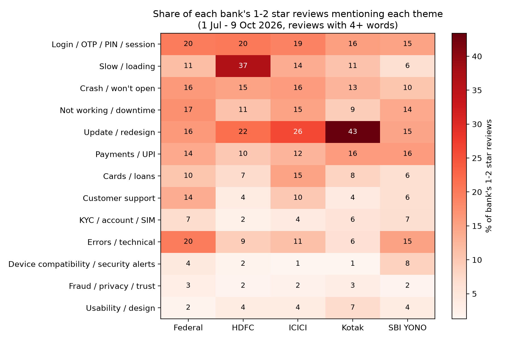
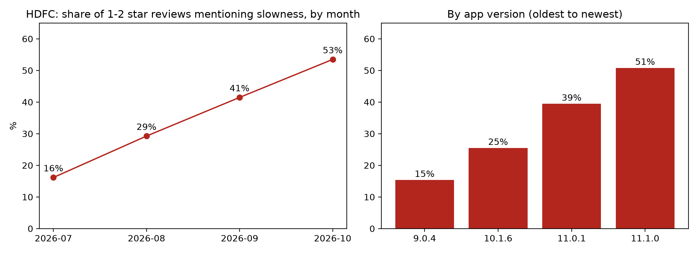

# Banking App Review Intelligence

### Understanding customer complaints in Indian banking apps using Python and NLP

**Author:** Koustav Das

---

## 1. About the Project

Why do customers give low ratings to banking apps? What problems do they face, and which issues should banks fix first?

This project analyses customer reviews of five popular Indian banking apps to answer these questions.

Using Python and Natural Language Processing (NLP), I analysed customer feedback, identified common complaints, compared banks and developed a product improvement roadmap for HDFC Bank.

**The main objective is simple: turn customer reviews into useful business and product decisions.**

## 2. Banking Apps Analysed

The project covers five Indian banking apps:

- SBI YONO
- HDFC Bank
- ICICI iMobile
- Kotak Mobile Banking
- Federal Bank (FedMobile)

The analysis uses public Google Play Store reviews collected over the same period: **1 July to 9 October 2026**.

## 3. Dataset at a Glance

Description :                            Number 
Total reviews collected :                37,459 
Reviews after cleaning:                  16,313
Negative reviews (1–2 stars):            9,582 
Banking apps compared:                   5 
Complaint theme coverage:                79.9% 

Reviews were cleaned by removing duplicates, empty reviews, very short text and non-English reviews.

## 4. Key Findings

### Finding 1: Federal Bank performs better on customer ratings

Federal Bank has the lowest percentage of negative reviews among the five apps.

 Bank                        Average Rating                          Negative Reviews 

Federal Bank                     4.4                                       11.8% 
HDFC Bank                        3.6                                       31.3% 
ICICI Bank                       3.5                                       33.2% 
Kotak Bank                       3.5                                       33.7%
SBI YONO                         3.5                                       35.1% 

**Business insight:** Federal Bank stands out positively, while the other four banks have relatively similar negative review percentages.

### Finding 2: Slowness is a major problem for HDFC Bank

Among HDFC's 1–2 star reviews, 36.6% mention slowness.

This is higher than the corresponding figures for other banks.

The problem also increased over time:

Month          Reviews mentioning slowness 
July                    16.2% 
August                  29.3% 
September               41.5% 
October                 53.5% 

The analysis also shows an increase in slowness complaints across newer app versions.

**Business insight:** HDFC should investigate app performance, loading time and possible backend issues.

### Finding 3: Customers complain about multiple issues

The analysis identified 13 complaint themes, including:

- Login and OTP problems
- Slow loading and performance
- App updates and redesign
- Payment and UPI issues
- App crashes and downtime
- Customer support problems
- Other banking app usability issues

Login problems appear across all five banks, suggesting that this is a wider digital banking challenge.

### Visual Results

The repository includes two important visualisations:

**1. Complaint comparison across banks**



This chart compares the percentage of negative reviews mentioning different complaint themes across the five banking apps.

**2. HDFC slowness analysis**



These charts help identify where HDFC needs improvement and how its performance complaints have changed over time.

## 5. Product Improvement Roadmap for HDFC

Based on the findings, I selected HDFC Bank as the focus for product recommendations.

I used the RICE framework to prioritise improvements.

RICE stands for:

- **Reach:** How many customers are affected?
- **Impact:** How much improvement will the solution create?
- **Confidence:** How confident are we in the proposed solution?
- **Effort:** How much work will it require?

The formula is:

RICE Score = (Reach × Impact × Confidence) / Effort

### RICE Results

Improvement Area     Reach      Impact      Confidence      Effort      RICE Score 
Slow / Loading       36.6         2            85%            3          **20.7** 
Update / Redesign    21.6         3            70%            4          **11.3** 
Login / OTP / PIN    20.3         2            80%            3          **10.8** 

### Recommended Actions

**Priority 1: Improve app speed**

Investigate slow loading, app performance and possible backend issues.

Success metric: Reduce the percentage of negative reviews mentioning slowness from the October baseline of 53.5%.

**Priority 2: Investigate update and redesign complaints**

Understand why customers are unhappy with app updates, missing features and interface changes before deciding what to redesign.

Success metric: Reduce negative reviews mentioning update and redesign issues.

**Priority 3: Improve login reliability**

Investigate OTP failures, login errors and session problems separately from slow loading.

Success metric: Reduce login-related complaints and improve successful login rates.

### RICE Sensitivity Test

I also performed 10,000 sensitivity simulations by changing the Impact, Confidence and Effort assumptions.

The results showed:

- App speed ranked first in 69% of simulations.
- App speed appeared in the top three in 94% of simulations.

This suggests that prioritising app performance is a reasonably robust decision, even when assumptions change.

## 6. How the Analysis Was Performed

The project follows six main steps:

1. **Data Collection:** Collected public customer reviews from Google Play Store using Python.
2. **Data Cleaning:** Removed duplicate, empty, very short and non-English reviews.
3. **Sentiment Analysis:** Evaluated VADER sentiment predictions against star ratings. Since its agreement was limited, star ratings were used to identify negative reviews.
4. **Complaint Identification:** Used keyword-based classification to identify 13 common complaint themes.
5. **Bank Comparison:** Compared negative review percentages and complaint patterns across five banking apps.
6. **Product Prioritisation:** Used RICE scoring and sensitivity simulations to recommend improvements for HDFC Bank.

## 7. Tools and Technologies

Tool        :           Purpose 
Python                  Main programming language 
Pandas                  Data cleaning and analysis 
NumPy                   Numerical calculations 
NLTK (VADER)            Sentiment analysis 
Regular Expressions     Text processing and keyword matching 
Matplotlib              Data visualisation 
Google Play Scraper     Collecting public app reviews 

## 8. Project Limitations

Some limitations should be considered when interpreting the results:

- Only English-language Android Google Play reviews were analysed.
- Very short reviews were excluded from complaint theme analysis.
- The keyword-based classifier does not identify every complaint and handles Hinglish poorly.
- Smaller review samples may produce less reliable comparisons.
- Customer reviews represent people who chose to leave feedback, not every banking customer.
- App version comparisons show associations, not proof that an update caused a problem.
- RICE impact, confidence and effort scores involve judgement and assumptions.

These limitations are important when interpreting the findings and making product decisions.

## 9. How to Run the Project

Follow these steps to run the analysis on your computer.

**Step 1: Clone the repository**

```bash
git clone YOUR_GITHUB_REPOSITORY_URL
```

**Step 2: Open the project folder**

```bash
cd banking-app-review-intelligence
```

**Step 3: Install the required libraries**

```bash
pip install -r requirements.txt
```

**Step 4: Collect the latest reviews**

```bash
python src/collect.py
```

**Step 5: Run the analysis**

Open the following notebook in Jupyter Notebook or VS Code:

```text
notebooks/01_clean_eda.ipynb
```

Run the notebook cells from top to bottom.

The analysis and visualisations are saved in the `outputs/` folder.

**Note:** The original review dataset is not included in this repository. Running the collection script again retrieves newer reviews, so the results may differ from the findings presented above.

## 10. Final Takeaway

This project demonstrates how customer feedback can be transformed into meaningful product decisions.

By analysing 37,459 reviews across five Indian banking apps, I identified customer pain points, compared digital banking experiences and developed a prioritised improvement roadmap for HDFC Bank.

**The key recommendation is to prioritise app performance and loading speed, supported by customer review trends and RICE sensitivity analysis.**

---

*Project by Koustav Das | Python | NLP | Customer Analytics | Product Strategy*